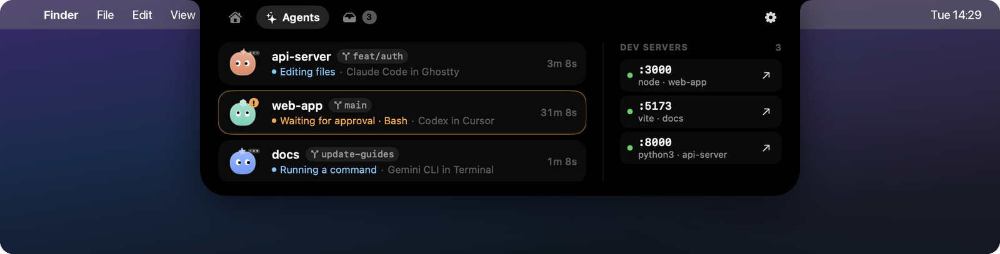
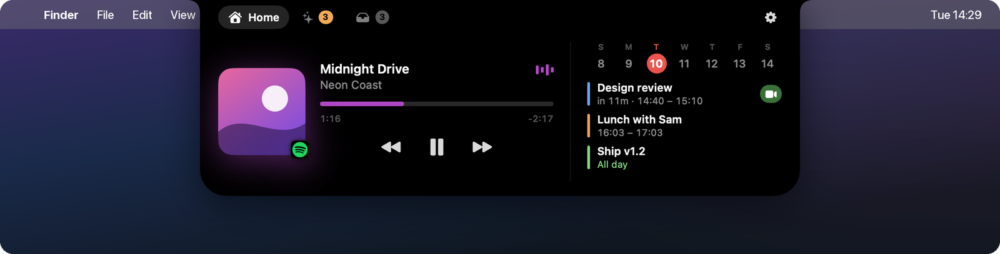
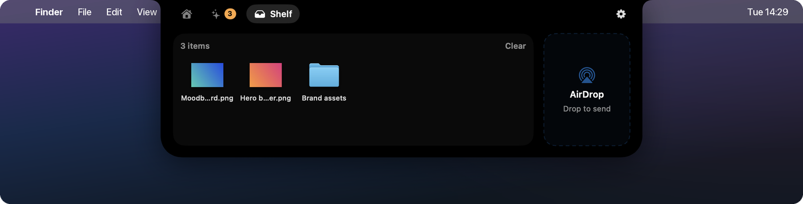
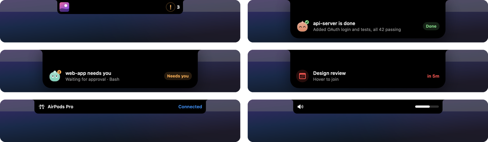

<div align="center">

# Isle

**A native Dynamic Island for your Mac's notch.**
Now playing, meetings, AirPods, file shelf, and a live view of every AI coding agent you have running.

[](https://github.com/Felix-Bergmann-Code/isle/actions/workflows/build.yml)
[](LICENSE)


[](CONTRIBUTING.md)

[Website](https://felix-bergmann-code.github.io/isle/) · [Contributing](CONTRIBUTING.md) · [Sister app: Gauge](https://github.com/Felix-Bergmann-Code/gauge)

<br>



</div>

---

Built with SwiftUI, AppKit and Core Animation. **No dependencies, no network, no telemetry.** The closed island idles at roughly 0% CPU.

## Install

Build from source (takes about a minute):

```bash
git clone https://github.com/Felix-Bergmann-Code/isle.git
cd isle
./scripts/build.sh --install --run   # builds, copies to /Applications and launches
```

Requires **macOS 15+** and **Xcode 16+** (or a Swift 6 toolchain). The script signs with your Apple Development identity if you have one, so macOS remembers permissions across rebuilds. Without one it signs ad-hoc. Drop `--install` to run from `./build` instead.

## What's in the island

| State | What you see |
| --- | --- |
| **Closed** | Blends into the hardware notch (a pill on displays without one). Grows slightly on hover. |
| **Live activity** | Album art + visualizer while music plays, and running agents (avatars + thinking dots + count). One more thing can join them on the right: a running timer, a download's progress, or the mic/camera dot. |
| **Mic & camera** | An orange (microphone) or green (camera) dot beside the notch while any app records, like on iPhone; the open header says which. |
| **HUD** | Volume / brightness level beside the notch. |
| **Banner** | Drops down when an agent finishes or needs you, when a long terminal command or a download finishes, when CI fails or a PR merges, 5 min before a meeting, and when AirPods or other devices connect. Also shows charging and low battery. |
| **Open** (hover) | Tabs: **Home** (player + calendar), **Agents**, **Shelf** (files, clipboard, a note). |

**Gestures:** hover to open, click the notch to open instantly, swipe left/right with two fingers to change tabs, drag files onto the notch to shelve them.




The open header keeps one row of small glances left of the battery, each shown only when it has something to say: the mic/camera dot, today's tokens (Agents tab), the weather (Home), a running timer, and the quiet-mode moon. Every feature has its own switch in Settings, which has one page per area and a search field.

**Live activities and banners** while the island is closed:



### Home
**Timer**: the timer glyph in the Home header unfolds into 5 / 15 / 25 / 45 minute presets. While it runs, the countdown sits beside the notch and in the header (hover it to pause or stop), and a banner and sound tell you when it ends. It survives relaunches. Settings → Home can add a 5-minute break after each 25-minute timer.

**Weather & clocks**: Home shows today's weather in the header (glyph + temperature; hover for the high and low). It comes from [Open-Meteo](https://open-meteo.com) with no key and no location permission: the city defaults to the one in your time zone and can be changed in Settings → Home. Only the city name and its coordinates are sent. Up to three teammate clocks ("NYC 04:12", with a moon at night there) can be added in the same place and sit at the bottom of the calendar.

**Camera mirror**: when a meeting with a video link starts within 15 minutes, its row on Home gets a small camera button. It swaps the player for a live mirror so you can check how you look before joining. The camera runs only while the mirror is on screen and stops when you close it, switch tabs or the island closes. Turn it off in Settings → Home.

### Agents tab

Detects **Claude Code** (terminal and desktop sessions), **Codex**, **Gemini CLI**, **Cursor Agent**, **Aider**, **opencode**, **Copilot CLI**, **Amp** and **Goose**. For each one you get:

- an animated avatar: bouncing = working, wiggling "!" = needs you, check = done, sleeping = idle
- project, git branch and current activity ("Running a command", "Editing files", "Waiting for approval · Bash")
- click to jump to the hosting app (Ghostty, Cursor, Claude…); hover for "open in editor" and "reveal"
- **Checks, pull requests and deploys** (needs the [GitHub CLI](https://cli.github.com), signed in): the branch chip's glyph shows CI on the branch (amber dot running, green check passed, red cross failed) and the PR number (purple once merged). Click it to open the PR or the latest run; hover the row for "Open preview" when a Vercel or Netlify preview is up. Banners when checks fail or pass, a PR is merged or reviewed, or a preview is ready. Asked every 45 s while checks run, every 3 min otherwise and right after an agent finishes; default branches are skipped. Switch it off in Settings → Agents.
- **Changes**: uncommitted changes in the agent's repo next to the branch ("+142 −37", or "+3 new" for only new files; hover for the files). The ± button on hover opens the repo in Fork, Tower, GitHub Desktop, Sourcetree, GitUp or Sublime Merge, else your editor. git runs in the background without taking locks: when a session changes phase, every 20 s while it works, and when you open the tab
- **Usage**: a small ring beside a Claude session's time once its context is half full (amber at 80%, red at 92%, hover for the numbers), and today's Claude Code tokens in the header with an estimated API-price cost and the last 5 hours on hover. Read from the transcripts, incrementally; Settings → Agents → Context & token usage turns it off.
- **Waiting nudges**: an agent that needs you shows how long it has waited, in amber. After 3 min the "!" beside the notch pulses softly, and the banner comes back once at 5 and once at 20 min. While the screen is locked or asleep, agent banners are held back; when you return after 2 min or more, one "While you were away" banner sums up who needs you and who finished. Settings → Agents → "Remind me when an agent keeps waiting".
- **Reply**: when a Claude Code turn ends on a question, answer it in one line under the session (Yes / No for yes-or-no questions). iTerm2 gets it typed in directly. The Claude app and Terminal get it pasted and sent; other terminals (Ghostty, Warp, editor terminals) get it pasted without pressing Return, so it can't run in the wrong tab. Pasting needs Accessibility; without it the reply is copied for you.
- **Dev servers**: every localhost port started from a project folder, with open/stop buttons. The dot shows health from a quick `HEAD /` while the panel is visible: green answers, amber slow or 5xx, red not responding, grey not HTTP (hover it for status and timing). If a server stops without you stopping it in Isle, a banner says so and its row stays dimmed for a minute (Settings → Agents → "Warn when a dev server stops").

How status is detected, from most to least precise:

1. **Claude Code hooks** (optional, exact and instant): *Settings → Hooks & Scripts → Install*. This adds a silent `curl` to `127.0.0.1:47823` for each hook event in `~/.claude/settings.json` and saves a backup next to it.
2. Claude transcripts in `~/.claude/projects/…/*.jsonl`, tail-parsed.
3. CPU activity of the agent's process tree. This works for every CLI, and Codex adds its session-file activity.

Anything can report itself:

```bash
curl -s -X POST localhost:47823/hook/custom \
  -d '{"id":"deploy","name":"Deploy","phase":"working","detail":"Uploading…"}'
# phase: working | waiting | done | idle | end
```

**Long commands**: start `swift build` or `npm test`, look away, and a banner tells you when it finished or failed (with the exit code and how long it took). Settings → Hooks & Scripts → Terminal commands → Install writes `~/.config/isle/isle.zsh` and adds one `source` line to `~/.zshrc` (a backup is saved next to it). The zsh hook posts silently in the background to `127.0.0.1:47823/hook/command` after anything that ran 10 s or longer; Isle only shows commands past your threshold (30 s by default). Editors, pagers, `ssh`, REPLs, agents and Ctrl-C are skipped, and nothing shows while the terminal that ran the command is in front.

### Shelf
Drop files on the notch to park them, drag them out later, or AirDrop them. Switch to **Clipboard** for your last 30 copies (text and images): click one to copy it again. Hover a row for one shortcut that fits what you copied: **Format** JSON, **Decode** a JWT or Base64 text, **Copy date** of a Unix timestamp (the row shows the date), **Open** a link. The history lives in memory only, skips anything password managers mark as concealed or copy, and can be turned off in Settings → Shelf.

**Note**: one plain-text note, saved to `~/Library/Application Support/Isle/note.txt` as you type; `isle note` opens it ready to type. Esc stops typing; ⌘Z brings back a cleared note. Turn it off in Settings → Shelf.

**Downloads**: Safari (`.download`), Chrome/Edge/Brave/Arc/Vivaldi (`.crdownload`) and Firefox (`.part`) downloads in ~/Downloads show a ring beside the notch: the percentage when the browser records the total size (Safari), otherwise the size so far. Finished files get a banner with their icon and land on the Shelf, so you can drag them straight out. Files that stop growing for a minute are ignored. Watching is event-driven (a folder vnode source); progress is re-read once a second only while something is downloading. Settings → Shelf → Downloads.

### Quiet mode
The moon in the open island's header holds back banners and sounds for focus time (right-click for "1 hour" or "until tomorrow"). The HUD and live activities stay, approval requests and meeting reminders still come through, and when quiet ends one banner sums up what you missed. Settings → Quiet Mode can turn it on during calendar calls and run a Shortcut when it starts or ends (apps can't switch macOS Focus themselves).

### Shell control

```bash
scripts/isle open:agents   # open | open:home | open:shelf | toggle | close
scripts/isle timer:25      # start a 25-minute timer · timer:stop cancels it
scripts/isle quiet         # quiet (toggle) | quiet:on | quiet:off
scripts/isle note          # the Shelf's note, ready to type · mirror opens the camera mirror
scripts/isle settings      # the settings window · settings:permissions (or agents, home, shelf…) opens a page
```

A development build can run beside the installed app: `open -n --env ISLE_INSTANCE=dev build/Isle.app` gives it its own command channel (`ISLE_INSTANCE=dev scripts/isle …`) and hook port (47824), leaves hook installs alone, logs every banner to `~/Library/Logs/Isle-dev.log`, and takes `click:x:y`, `type:text` and `key:esc` commands for scripted UI tests.

### Demo mode

`--demo` fills the island with made-up music, meetings, agents, dev servers and shelf files, and doesn't read anything from your Mac. Use it for screenshots and screen recordings (all screenshots here were made with it):

```bash
open build/Isle.app --args --demo
scripts/isle demo:agent    # demo:agent | demo:waiting | demo:meeting | demo:airpods | demo:volume | demo:charging
```

## Performance

- The window is never resized. Only SwiftUI shapes animate, using springs.
- Animations that stay on screen while closed (visualizer, thinking dots, avatar motion, the waiting pulse) are Core Animation layer animations. They run in the render server, so the closed island uses roughly 0% CPU. The one exception is a running timer's countdown, which redraws once a second.
- Agent scanning uses one `sysctl` per tick plus cached classification, and tail-parses transcripts only when their mtime changes. Measured at about 1% CPU with a live activity showing.
- git, gh and port checks run in the background, only for repos and servers you can see, and back off when nothing changes. Dev server crash warnings re-scan ports every 30 s only while at least one dev server is running.
- Now Playing uses Spotify's and Music's distributed notifications (push, no polling). The position re-syncs only while the player is visible.

## Permissions

Automation for Spotify/Music (controls and artwork), Calendar, Bluetooth (connect banners), the Downloads folder (once, for download progress), and Camera (only when you open the mirror). Accessibility is needed only if you turn on *Replace the system volume & brightness HUD*, or to paste agent replies for you (iTerm2 needs only Automation; Terminal uses Automation to pick the right tab). See [SECURITY.md](SECURITY.md) for exactly what Isle reads and writes.

## Known limits

- Now Playing covers Spotify and Apple Music. Since macOS 15.4, browser and other media aren't readable without private-API workarounds.
- No lock-screen widgets yet. They need private SkyLight APIs.

## Contributing

PRs are very welcome! Good places to start:

- support for another AI agent or terminal in the Agents tab
- more Now Playing sources
- an app icon 🙂
- testing on notch-less and external displays

Read [CONTRIBUTING.md](CONTRIBUTING.md) to get set up. Please follow the [Code of Conduct](CODE_OF_CONDUCT.md).

## Project layout

```
Sources/Isle/
  App/        app entry, settings, island state machine
  Window/     the borderless notch window
  Views/      SwiftUI views (closed, compact, open tabs, settings)
  Services/   media, calendar, system (volume, battery, Bluetooth), shelf, clipboard, note,
              timer, weather, downloads, camera mirror, mic/camera use
  Agents/     agent detection, process info, ports and their health, the hook server,
              usage, diffs, CI status, replies, terminal commands
scripts/      build.sh, isle (shell control)
```

## License

[MIT](LICENSE) © Felix Bergmann and contributors
